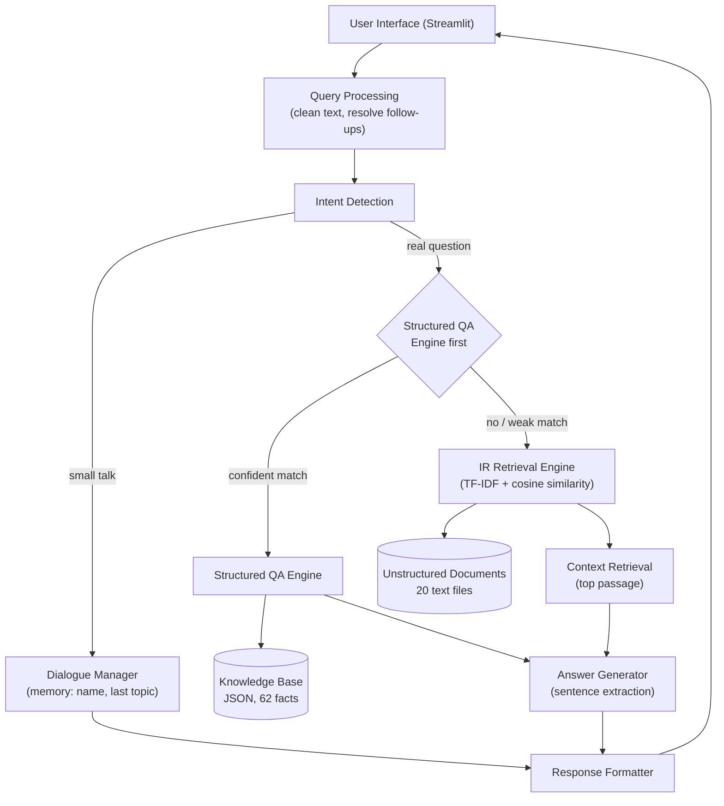

# Intelligent Question Answering and Chatbot System

**Information Retrieval · Knowledge-Based QA · Dialogue Management**

A 3rd-year B.E. AI & ML mini project: a working chatbot that answers questions from
free-text documents (IR-based QA), answers factual questions from a structured
knowledge base (Knowledge-based QA), and handles small talk through a rule-based
dialogue manager with short-term memory.

---

## 1. Project Overview

Faculty-style problem statements for QA chatbots usually ask for three things at once:
an IR engine over unstructured text, a structured QA engine over a knowledge base, and
basic conversational ability. This project implements all three behind one orchestrator
(`src/chatbot.py`) and exposes them through a Streamlit chat interface.

## 2. Objective

- Build a QA system that extracts relevant passages for a user question and answers
  factoid questions from text documents.
- Build a structured knowledge base and a matching engine for exact factual queries.
- Add a dialogue manager for greetings, thanks, farewells and simple memory
  (e.g. remembering the user's name and the topic of the last question).
- Evaluate the system quantitatively (routing accuracy, retrieval accuracy, precision/
  recall/F1, confidence, response time) on a hand-built test set.

## 3. Features

- **IR-based factoid QA** — TF-IDF (uni+bigrams) over 20 documents / 40 paragraphs,
  cosine similarity ranking, sentence-level answer extraction, confidence score.
- **Knowledge-based QA** — 62-entry structured JSON knowledge base across 6 categories,
  matched with a blend of TF-IDF similarity and fuzzy string matching, with an
  out-of-vocabulary guard so the bot does not confidently answer things it was never
  told (e.g. "Who invented Java?").
- **Dialogue management** — intent detection for greetings/thanks/bye/how-are-you,
  name memory, last-topic memory used to resolve simple follow-ups ("Who invented
  it?" after "What is Python?"), and a fallback response.
- **Streamlit UI** — chat bubbles, mode badge (Dialogue / Knowledge QA / IR QA /
  Fallback), confidence bar, response time, expandable retrieved context, example
  question buttons, Clear Chat button.
- **Evaluation suite** — precision/recall/F1 per mode, IR top-1/top-3 retrieval
  accuracy, answer accuracy, mean confidence, average response time, with
  Matplotlib charts.

## 4. Architecture



**Data flow:** the user's message is cleaned and checked for small talk first. Real
questions are tried against the structured Knowledge Base before falling back to the
IR engine over the unstructured documents, because structured facts are exact. If
neither source is confident, the dialogue manager returns a fallback message instead
of guessing.

## 5. Technologies Used

| Purpose | Technology |
|---|---|
| Language | Python 3.11+ |
| Retrieval / vectorisation | scikit-learn (`TfidfVectorizer`, `cosine_similarity`) |
| Data handling | pandas, NumPy |
| Structured KB | JSON |
| UI | Streamlit |
| Notebooks | Jupyter / nbformat |
| Evaluation charts | Matplotlib |

No paid APIs are used; everything runs fully offline.

## 6. Folder Structure

```text
QA_Chatbot/
│
├── app.py                     # Streamlit application
├── requirements.txt
├── README.md
│
├── data/
│   ├── documents/              # 20 unstructured text documents
│   ├── knowledge_base.json     # 62 structured Q&A entries
│   └── sample_questions.csv    # 28-question evaluation set
│
├── notebooks/
│   ├── preprocessing.ipynb     # Steps 1-3 of the pipeline, executed
│   ├── retrieval.ipynb         # Steps 4-8 of the pipeline, executed
│   └── evaluation.ipynb        # Full evaluation run, executed
│
├── src/
│   ├── preprocessing.py        # cleaning, tokenisation, document loading
│   ├── retriever.py            # TF-IDF IR engine
│   ├── knowledge_qa.py         # structured KB matching engine
│   ├── dialogue.py             # intent detection + dialogue state
│   ├── chatbot.py              # orchestrator (routing, memory, formatting)
│   ├── evaluation.py           # metrics computation
│   └── utils.py                # shared helpers
│
├── results/                    # evaluation_results.csv, metrics, charts (generated)
└── screenshots/                # add your own screenshots here for submission
```

## 7. Installation

```bash
# 1. Create and activate a virtual environment (recommended)
python -m venv venv
venv\Scripts\activate        # Windows
source venv/bin/activate     # macOS/Linux

# 2. Install dependencies
pip install -r requirements.txt
```

## 8. How to Run

**Run the chatbot UI:**
```bash
streamlit run app.py
```
Then open the URL Streamlit prints (usually `http://localhost:8501`).

**Run the notebooks** (VS Code → open `notebooks/*.ipynb` → select a Python kernel →
Run All), or from the command line:
```bash
jupyter notebook notebooks/
```

**Re-run the evaluation and regenerate charts from the command line:**
```python
from src.evaluation import run_evaluation, per_mode_metrics, summary
results = run_evaluation()
print(per_mode_metrics(results))
print(summary(results))
```

## 9. Sample Screenshots

> Add screenshots of the running Streamlit app here before submission, e.g.:
> `screenshots/chat_dialogue.png`, `screenshots/chat_ir_qa.png`,
> `screenshots/chat_knowledge_qa.png`.

## 10. Evaluation Snapshot (experimental, on the project's own 28-question set)

| Metric | Value |
|---|---|
| Routing accuracy | 100% |
| Answer accuracy | 100% |
| IR retrieval top-1 accuracy | 100% |
| IR retrieval top-3 accuracy | 100% |
| Mean confidence | ~0.61 |
| Average response time | ~3-4 ms |

These numbers are experimental results measured on the hand-built dataset created for
this project (20 documents, 62 KB facts, 28 test questions) — they describe how well
the system performs on data representative of its own scope, not a general-purpose
benchmark. See `results/` and `notebooks/evaluation.ipynb` for full details.

## 11. Future Enhancements

- Swap TF-IDF for sentence-transformer embeddings (e.g. `all-MiniLM-L6-v2`) with FAISS
  for semantic retrieval instead of lexical matching.
- Add an extractive QA model (e.g. a fine-tuned BERT) for more precise answer spans.
- Expand the knowledge base with a real SQLite backend and an admin UI for adding facts.
- Add multi-turn dialogue state tracking (slot filling) beyond simple topic memory.
- Deploy the Streamlit app publicly (Streamlit Community Cloud) for live demos.
